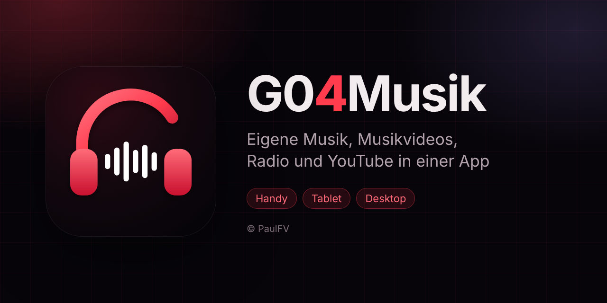

# G04Musik v0.2.2



**Eigene Musik, Musikvideos, Radio und YouTube in einer App** – als installierbare Web-App für
**Handy, Tablet und Desktop**. Ohne Backend, ohne Konto, ohne Tracking. Deine Dateien bleiben auf dem Gerät.

**Live:** https://paulfv.github.io/G04Music/

Gebaut wie [G04TV](https://github.com/PaulFV/G04TV): reines HTML, CSS und JavaScript, kein Framework.

---

## Was G04Musik kann

| Bereich | Beschreibung |
|:--|:--|
| **Start** | Oben die Bühne (Cover, Spektrum oder Video), darunter die Reiter **Favoriten**, **Songs**, **Videos**, **Radio**, **YouTube** und **Verlauf** |
| **Meine Musik** | Eigene Songs und Musikvideos hinzufügen, suchen, nach **Alben** ordnen |
| **Radio** | Über 30.000 Sender über [radio-browser.info](https://www.radio-browser.info): nach Land, Genre oder Namen |
| **YouTube** | Links zu Videos und Playlisten merken und im eingebetteten Player abspielen |
| **Einstellungen** | Visualizer, Bildschirm an, Einschlaf-Timer, Wiederholen, Zufall, Bibliothek, Installieren |

### Eigene Dateien
* **Musik:** MP3, M4A/AAC, FLAC, WAV, OGG, Opus (je nach Browser auch AIFF, WMA)
* **Musikvideos:** MP4, M4V, WebM, MOV; MKV meist in Chrome und Edge. AVI und WMV können Browser in der Regel nicht.
* Titel, Künstler, Album, Nummer und **Cover** werden aus den Tags gelesen (ID3 bei MP3, iTunes-Tags bei M4A/MP4). Ohne Tags
  hilft der Dateiname („Künstler - Titel.mp3“). Videos bekommen automatisch ein Vorschaubild.
* Ganze **Ordner** auf einmal (Desktop-Browser). Gespeichert wird in der **IndexedDB** des Browsers.

### Wiedergabe
* **Bühne** mit echtem Spektrum (Web Audio) für eigene Songs; bei Radio nachgebildet. Videos laufen direkt auf der Bühne,
  mit **Vollbild** und **Bild-in-Bild**.
* **Mini-Player** unten rechts, sobald die Bühne nicht zu sehen ist – die Musik läuft beim Blättern weiter.
* **Sperrbildschirm, Kontrollzentrum, Auto** (Media Session): Titel, Cover, Weiter/Zurück.
* **Einschlaf-Timer** 15–90 Minuten, am Ende wird es leiser. **Wiederholen** (alle/einen), **Zufall**,
  **Als Nächstes spielen**.
* **Kacheln oder Liste:** ein Knopf oben in der Kopfzeile wechselt die Ansicht für die ganze App, die Wahl wird gemerkt.
* **Stern** oben rechts auf jeder Kachel (Songs, Videos, Radiosender, YouTube): Favorit an/aus, ohne abzuspielen.
* **Lang drücken** (oder Rechtsklick) auf eine Kachel: Favorit, als Nächstes, Infos, löschen.
* Tastatur am Rechner: Leertaste = Pause, N/P = weiter/zurück, F = Vollbild, M = Ton aus.

### Bildschirmgrößen
* **Desktop** (ab 1200 px): volle Seitenleiste, Bühne und Bedienfeld nebeneinander.
* **Tablet** (768–1199 px): schmale Leiste; **quer** geteilt – Bühne links, Inhalt rechts; **hochkant** Bühne oben.
* **Handy** (unter 768 px): untere Leiste, Bühne auf Start, sonst Mini-Player; **quer** Bühne neben dem Bedienfeld.

### Gut zu wissen
* **iPhone/iPad:** Dort ist das Spektrum nachgebildet, weil iOS die Musik sonst im Hintergrund stummschaltet.
* **YouTube** spielt nicht weiter, wenn der Bildschirm gesperrt ist (Vorgabe von YouTube). Manche Videos erlauben kein Einbetten.
* **Radio-Sender** mit HLS (`.m3u8`) laufen über [hls.js](https://github.com/video-dev/hls.js), das bei Bedarf nachgeladen wird.
* Auf HTTPS werden nur Sender mit HTTPS-Stream angezeigt (Browser blockieren sonst den Ton).

---

## Aufbau

```
index.html            Rahmen, Bühne, Mini-Player, Blatt
manifest.webmanifest  Installation als App
sw.js                 Service Worker (App-Dateien offline)
css/  theme · layout · components · player · responsive
js/   util · db (IndexedDB) · id3 (Tags) · store · library · radio · youtube · player · views · app
img/                App-Icons (rote Kopfhörer mit Klangwelle)
```

## Starten

* **Online:** GitHub Pages → Einstellungen des Repos → *Pages* → Branch `main`, Ordner `/ (root)`.
* **Lokal:** im Ordner `python -m http.server 8000` und `http://localhost:8000` öffnen.
  (Direkt per Doppelklick geht vieles auch, YouTube und der Offline-Modus brauchen aber eine richtige Adresse.)

## Nächste Schritte (Phase 2)
Liedtexte (.lrc) mitlaufend, Crossfade, Playlisten selbst anlegen, Hell/Dunkel, Englisch, Play-Store-Version (TWA).

---

© PaulFV
